# حاملة مفاتيح وأغراض للمدخل — تصاميم بآية ﴿وَلَسَوْفَ يُعْطِيكَ رَبُّكَ فَتَرْضَىٰ﴾

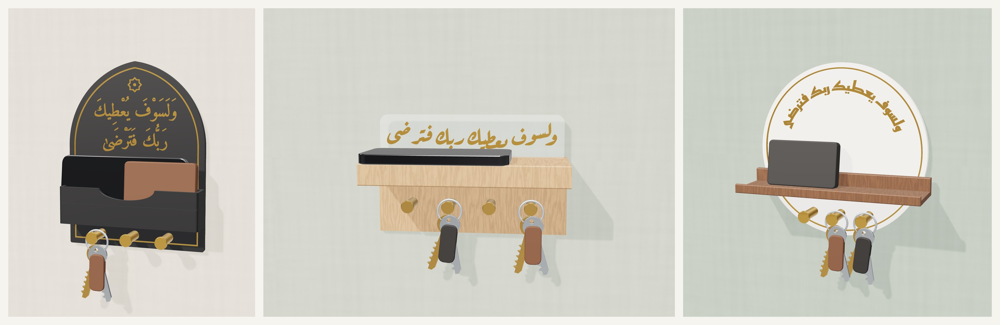

ثلاثة تصاميم بسيطة وراقية لمدخل البيت. كل تصميم يجمع بين:

- خطاطيف للمفاتيح
- مكان للأغراض الشخصية (الجوال، المحفظة، النظارة)
- الآية مكتوبة بخط جميل وبلونين

**الأفكار المستوحاة من التصاميم الرائجة**

| الفكرة الرائجة | أين استخدمتها |
|---|---|
| شكل القوس أو البوابة، وهو من أكثر أشكال حاملات المدخل انتشاراً | التصميم 1 |
| الرف الخشبي العائم مع خط عربي واقف عليه (مثل الصورة اللي أرسلتها) | التصميم 2 |
| اللوح الدائري بالخط الذهبي، مثل لوحات الخط الدائرية | التصميم 3 |
| مزيج الأسود والذهبي، أو الخشب مع النحاسي، والأكريليك الشفاف مع الخط الذهبي | ألوان التصاميم الثلاثة |

---

## 1) المحراب — The Arch

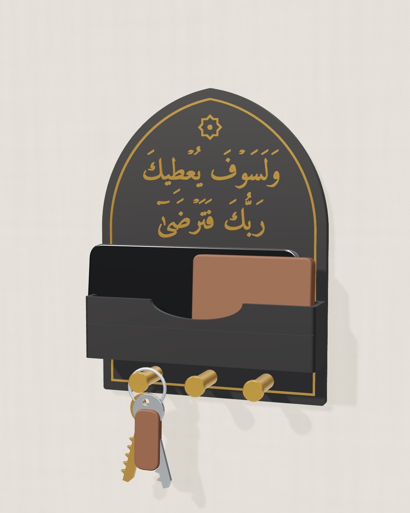

**الشكل**
- قوس مدبّب أسود مطفي، يشبه باب البيت والمحراب.
- الآية مكتوبة بالتشكيل الكامل على سطرين بخط النسخ القرآني (أميري قرآن).
- إطار ذهبي رفيع ونجمة ثمانية صغيرة فوق الآية.

**الاستخدام**
- جيب بعرض اللوح كامل للجوال (بالعرض)، والمحفظة والسماعات. الجيب فيه فتحة منحنية في الوسط حتى تمسك أغراضك بسهولة.
- ثلاثة خطاطيف ذهبية للمفاتيح.

**البيانات**
- المقاس: 160 × 210 مم، والبروز عن الجدار 37 مم للجيب و42 مم للخطاطيف.
- القطع: اللوح، والجيب، و3 خطاطيف.
- التعليق: بفتحتي تعليق مخفيتين في ظهر اللوح.

**ملاحظة:** الأغراض في الجيب لا تغطي الآية. الجوال بالعرض يصل إلى 103 مم، وأسفل حروف الآية يبدأ من 109 مم.

## 2) الرف العائم — The Floating Shelf (الأقرب لصورتك)


**الشكل**
- رف بلون الخشب الفاتح.
- الآية بخط الرقعة الذهبي، مطبوعة على لوح شفاف مطفي واقف على الرف. من مسافة يظهر الخط وكأنه واقف وحده، مثل الصورة اللي أرسلتها.

**الاستخدام**
- الرف يتسع للجوال مسطّحاً، والمحفظة والنظارة.
- تحت الرف أربعة خطاطيف نحاسية.

**البيانات**
- المقاس: 210 × 133 مم (مع الخط)، والعمق 90 مم.
- القطع: جسم الرف، ولوح الخط، و4 خطاطيف.
- التعليق: ببرغيين مخفيين تحت الرف.
- لوح الخط يدخل في مجرى في سطح الرف.

## 3) البدر والأفق — Moon over the Horizon


**الشكل**
- قرص عاجي بقطر 200 مم مثل البدر.
- الآية بالخط الكوفي الحديث الذهبي، تدور مع حافته العليا داخل حلقة ذهبية.
- رف بلون الجوز يقطع القرص مثل خط الأفق ويمتد خارجه من الجانبين. فكرة القمر الطالع فوق الأفق تناسب معنى الوعد في الآية.

**الاستخدام**
- الرف للمحفظة والنظارة والساعة.
- تحت الرف ثلاثة خطاطيف ذهبية.

**البيانات**
- المقاس: 210 × 200 مم، والبروز 67 مم.
- القطع: القرص، والرف، و3 خطاطيف.
- التعليق: بفتحتي تعليق مخفيتين.

## 4) القوس المضلّع — The Fluted Arch (حسب الصورة الأخيرة)


**الشكل**
- نصف دائرة سوداء مطفية فيها أضلاع طولية ناعمة، مثل الصورة.
- رف مستقيم بزوايا أمامية مدوّرة، وتحته لوح فيه ستة خطاطيف أسطوانية.

**الآية**
- مكتوبة بخط الرقعة الذهبي وتتوّج القوس من فوق.
- قطعة مستقلة من الحروف فقط، وليس وراءها إلا الجدار.
- الحروف واقفة على خط ذهبي رفيع يلف حافة القوس وينزل إلى الرف. هذا الخط يجعل الآية كلها قطعة واحدة تُطبع لوحدها، ويمكن تعليقها لوحدها أيضاً.

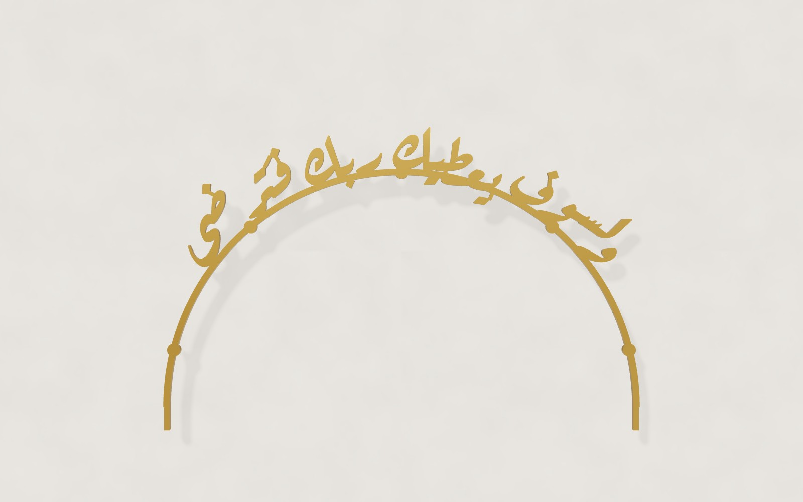

**البيانات**
- المقاس الكلي: 210 × 198 مم، والعمق 92 مم.
- القطع:

  | القطعة | المقاس | ملاحظة |
  |---|---|---|
  | `panel.stl` | 210 × 183 مم | |
  | `shelf.stl` | 210 × 85 مم | |
  | `verse.stl` | 205 × 130 × 3.2 مم | |
  | `peg.stl` | | اطبعه 6 مرات |

- كل القطع تُطبع بدون دعامات، وكلها تدخل في سرير 220 مم:
  - اللوح: يُطبع على ظهره والأضلاع للأعلى.
  - الرف: يُطبع مقلوباً، فيطلع سطحه العلوي ناعماً من سطح الطابعة.
  - الآية: تُطبع ووجهها على السطح والمسامير للأعلى.
  - الخطاطيف: تُطبع واقفة على رأسها.
- الألوان المقترحة: PLA أسود مطفي، والآية PLA ذهبي حريري.
- لون الخطاطيف: أسود مثل الصورة، أو ذهبي ليتماشى مع الآية.

**التركيب**
1. الصق الخطاطيف في فتحاتها (قطر الفتحة 8.4 مم) بغراء.
2. ثبّت الرف بثلاثة براغي M3 × 12 من خلف اللوح. البراغي مخفية تماماً.
3. علّق اللوح على ثلاثة براغي في الجدار عبر فتحات التعليق المخفية في الظهر:
   - واحد في الأعلى.
   - اثنان في الأسفل، والمسافة بينهما 132 مم.
4. ركّب الآية: 5 مسامير صغيرة (Ø2.5) في ظهرها تدخل في 5 فتحات في حافة القوس، مع نقطة غراء. أسفل طرفيها يرتكز على الرف.

**تقييمي قبل الإرسال (وما الذي عدّلته بناءً عليه)**

ما عدّلته أثناء التقييم:
1. **مكان الآية:** في النسخة الأولى وضعت الآية داخل القوس. كانت الحروف صغيرة، وأي غرض على الرف (مثل النبتة) يغطيها، والكلمات على الأطراف مائلة وصعبة القراءة. نقلتها فوق القوس مثل التاج: صارت أكبر (حجم الخط 25.7 مم)، وما في شيء على الرف يقدر يغطيها.
2. **البراغي:** براغي تثبيت الرف كانت ظاهرة تحت الرف من الأمام، فنقلتها للخلف.
3. **تداخل:** وجدت تداخلاً بين الأضلاع وسطح الرف بمقدار 0.5 مم، وصححته. الآن فحص التركيب يثبت أن القطع لا تتداخل.

ما فحصته في النسخة النهائية:
- **الآية قطعة واحدة متصلة:** نقاط الحروف موصولة بجسور صغيرة (5 جسور فقط).
- **دقة الخط:** 0.06% فقط من مساحة الآية أرفع من 0.8 مم، يعني تُطبع بوضوح بفتحة 0.4 مم.
- **الأحمال (حسابات تقديرية):**
  - الرف: 2 كغ عليه تعطي شداً حوالي 30 نيوتن على كل برغي، وهذا أقل بكثير من تحمّل البرغي.
  - الخطاطيف: 1 كغ على كل خطاف يعطي إجهاداً حوالي 7 ميجاباسكال عند لسان التثبيت، ضمن تحمّل PLA.

نقاط انتبه لها:
- **هشاشة الآية قبل التركيب:** الخط الذهبي الذي تقف عليه الحروف رفيع (2.4 مم)، فالقطعة مرنة. امسكها بحذر، واستخدم Brim عند الطباعة.
- **فتحات المسامير:** على بعد 2.5 مم فقط من حافة القوس، فاضغط المسامير برفق.
- **حجم القطعة:** المقاس محكوم بسرير 220 مم، فالقطعة أصغر من المنتج في الصورة (غالباً حوالي 40 سم). لو تبيها أكبر، أقسمها لك على عدة قطع، أو أكبّر المقاسات لو سرير طابعتك أكبر.
- **الخط:** خط حاسوبي مفتوح الرخصة (عارف رقعة)، وليس خط يد خطاط.

## 5) اللوح الخشبي — The Walnut Board (حسب الصورة)

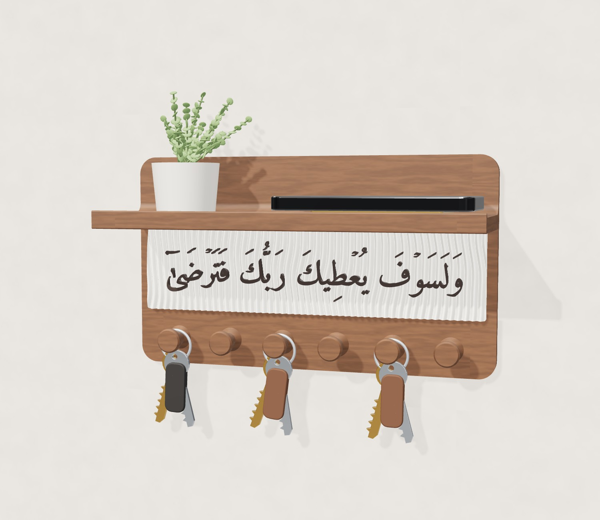

لوح بلون الجوز بزوايا مدوّرة، ورف علوي، ولوح أبيض بتموّجات طولية ناعمة، ومقابض نحاسية. الآية **بلون غامق (بني قهوة) مع كامل التشكيل** بالرسم العثماني، مكتوبة بخط النسخ القرآني (أميري قرآن)، وبارزة من التموّجات البيضاء.


### صحة نص الآية

النص المستخدم هو النص كما في مصحف المدينة (رواية حفص):

> **وَلَسَوۡفَ يُعۡطِيكَ رَبُّكَ فَتَرۡضَىٰٓ** — سورة الضحى، الآية 5

- **المقارنة:** قارنتُ النص حرفاً بحرف مع مصدرين مستقلين لنص القرآن:
  - نص Tanzil (قاعدة بيانات SQLite).
  - نص quran-json العثماني.
- **النتيجة:** المصدران متطابقان في كل حرف وكل حركة. الفرق الوحيد في رمز السكون: أحدهما يكتبه دائرياً (ْ)، والآخر بشكل رأس الخاء الصغير (ۡ) كما في مصحف المدينة، واعتمدتُ رمز مصحف المدينة.
- **الحفظ في الكود:** النص محفوظ في `common/kh.py` كرموز يونيكود مكتوبة واحداً واحداً، حتى لا يتغيّر بالخطأ. ومعه فحص يتأكد أن حروفه بدون التشكيل هي «ولسوف يعطيك ربك فترضى».
- **التشكيل الموجود:**
  - الفتحات.
  - ضمة الياء في «يُعۡطِيكَ».
  - السكون على الواو والعين والراء.
  - كسرة الطاء.
  - الشدة مع الضمة على الباء في «رَبُّكَ».
  - الألف الخنجرية والمدّ على «فَتَرۡضَىٰٓ».
- **فحص النقاط:** راجعت كل النقاط (ف، ي، ب، ت، ض) في الرسم وفي صورة العرض ثلاثية الأبعاد. كل نقطة وحركة على حرفها الصحيح.
- **تصحيح للتصميم 1:** في التصاميم السابقة كانت علامة المدّ (ٓ) ناقصة على «فترضىٰٓ». صححتها هنا وفي التصميم 1 أيضاً.

> المصادر المباشرة (quran.com و tanzil.net) لم تكن متاحة من بيئة العمل، فاعتمدتُ على نسخ نصوصها المنشورة. أنصح بمطابقة القطعة بالمصحف قبل الطباعة النهائية.

### المقاسان

المقاسان الآن بنفس الطريقة: **قطعتان فقط** وبدون براغي. القطعة الأولى بنية فيها اللوح والرف والمقابض معاً، والثانية قاعدة الآية وتُلصق.

| | الصغير | 30 سم |
|---|---|---|
| المقاس الكلي | **210 × 122 مم**، عمق 92 مم (رف 10 مم مع حافة للجوال) | **300 × 174 مم**، عمق 92 مم (رف 11 مم مع حافة للجوال) |
| حجم الآية | 180 × 35 مم | 248 × 48 مم |
| عدد المقابض | 5 | 6 |
| القطع | قطعتان: البنية (لوح + رف + مقابض) وقاعدة الآية | قطعتان: البنية (لوح + رف + مقابض) وقاعدة الآية |
| أكبر قطعة | 210 × 122 × 92 مم | 300 × 174 × 92 مم |
| الوزن | **242 غ** | **418 غ** |
| وقت الطباعة* | ≈ 7 ساعات | ≈ 12 ساعة |
| يناسب سرير | 330 × 320 (Bambu Lab A2L)، ويدخل أيضاً في سرير 220 × 220 | 330 × 320 (Bambu Lab A2L) |

\* بسرعات قريبة من Bambu.

### المقاس الصغير لطابعة Bambu Lab A2L — نفس طريقة 30 سم

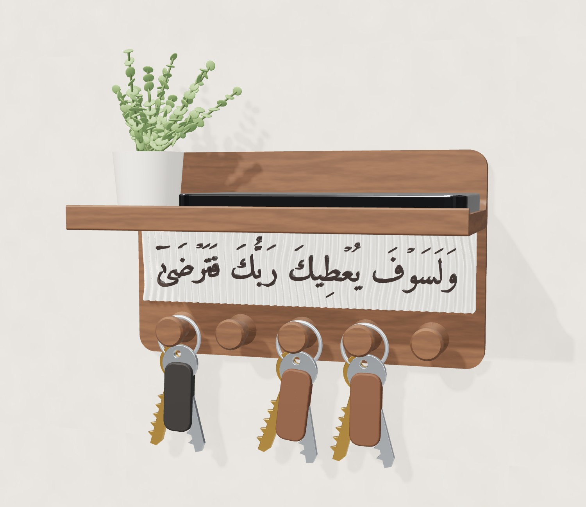

**القطع**
- **القطعة البنية (قطعة واحدة جاهزة):** اللوح والرف والمقابض الخمسة مطبوعة معاً. **بدون براغي** ولا تركيب.
- **قاعدة الآية:** اللوح الأبيض مع الآية الغامقة، تُطبع لحالها وتُلصق في تجويفها تحت الرف.
- **للتعليق:** برغيين في الجدار فقط، والمسافة بينهما **140 مم**.

**`05-walnut-board/small/walnut_board_small_print_kit.zip`** فيه:
- طبعتين (3MF).
- ملفات STL.
- صور.
- الدليل العربي `guide-ar.pdf`.

| الطبعة | الملف | الإعدادات | الوزن | الوقت* |
|---|---|---|---|---|
| 1 | `plates/1_brown_main_board_shelf_knobs.3mf` | 4 جدران، حشو 15% | 204 غ | 5h 27m |
| 2 | `plates/2_white_panel_dark_verse.3mf` | 2 جدار، حشو 10% | 38 غ (منها حوالي 4 غ غامق) | 1h 39m |
| | **المجموع** | | **242 غ** | ≈ 7 ساعات |

\* الوقت تقدير بسرعات قريبة من Bambu.

**الهدر:** كل طبعة بخيط واحد. التبديل الوحيد في قاعدة الآية، إلى الغامق عند **7.0 مم**.

**القوة (بدون براغي)**
- **الرف:**
  - سماكته **10 مم**، وعمقه **85 مم**.
  - يتسع لجوال عرضه حتى 73 مم وهو مسطّح.
  - جذره مدوّر بنصف قطر **6 مم** من فوق.
  - حافته الأمامية ترتفع 3 مم.
- **المقابض:** رقبة **12 مم** (نفس سماكة مقابض 30 سم)، وقاعدة مخروطية 3.5 مم، ورأس 18 مم.
- **الحساب النظري:**

  | الحمل | الإجهاد |
  |---|---|
  | 5 كغ على الرف | ≈ 0.6 ميجاباسكال |
  | ضغط 10 كغ على حافة الرف | ≈ 4 ميجاباسكال |
  | 2 كغ على المقبض | ≈ 2 ميجاباسكال |

  قوة التصاق طبقات PLA الجيد 15–25 ميجاباسكال، يعني أمان 4–5 أضعاف أو أكثر.
- **الاستخدام المقترح:** نفس 30 سم: الرف حتى **5 كغ**، وكل مقبض حتى **2 كغ**.

**مقارنة بالنسخة الصغيرة السابقة (198 غ):** الجديدة أثقل بحوالي 44 غ، لأن الرف صار أعمق (85 مم بدل حوالي 55 مم) حتى يتسع للجوال مسطّحاً، ولأن القطعة البنية صارت بأربعة جدران للقوة، ورقبة المقابض صارت 12 مم بدل 8. في المقابل، لم تعد تحتاج براغي M3 ولا مقابض نحاسية تُطبع وتُلصق لحالها.

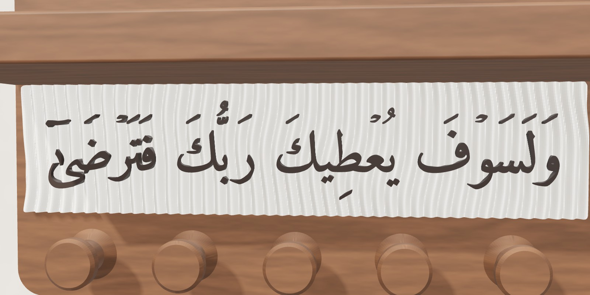
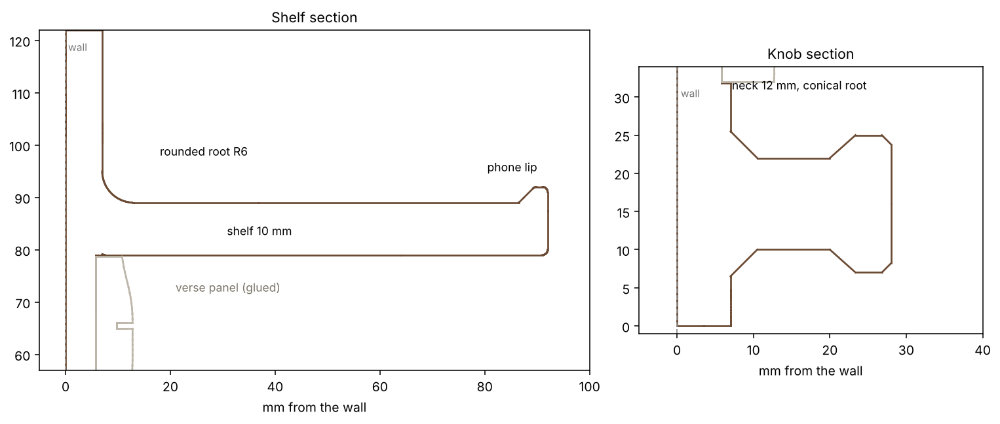
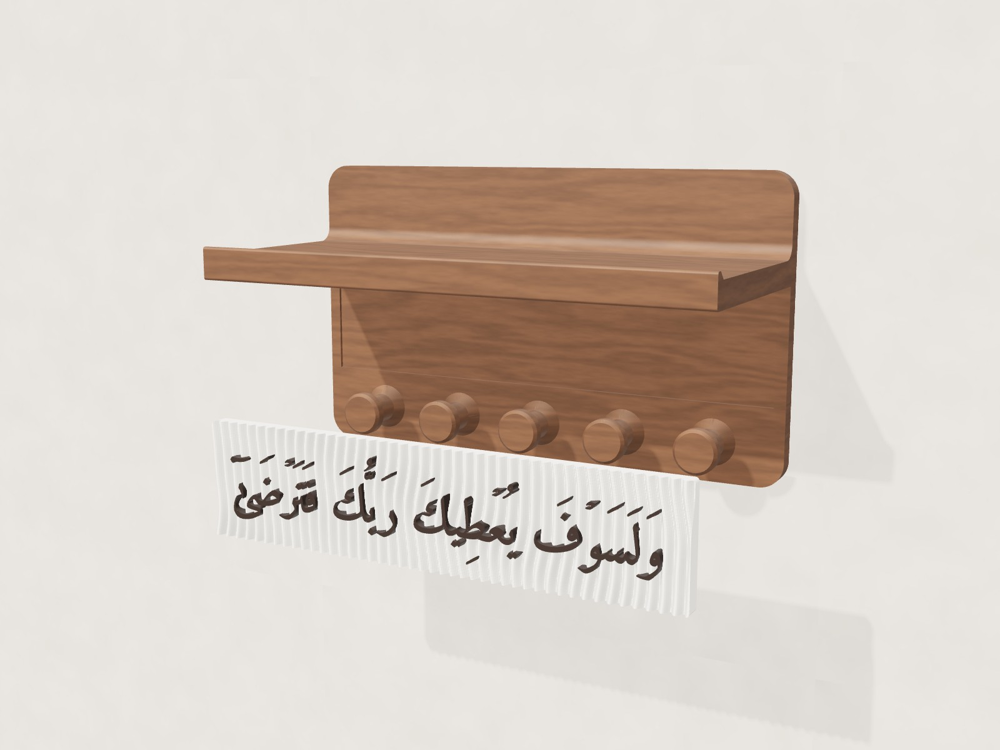

### مقاس 30 سم لطابعة Bambu Lab A2L — قطعة قوية واحدة جاهزة + قاعدة الآية

سرير الـ A2L مقاسه 330 × 320 مم، فلا يوجد أي تقطيع.

**القطع**
- **القطعة البنية (قطعة واحدة جاهزة):** اللوح والرف والمقابض الستة مطبوعة معاً. **بدون براغي** ولا تركيب.
- **قاعدة الآية:** اللوح الأبيض مع الآية الغامقة، تُطبع لحالها وتُلصق في تجويفها تحت الرف.
- **للتعليق:** برغيين في الجدار فقط.

**`05-walnut-board/30cm/walnut_board_30cm_print_kit.zip`** فيه:
- طبعتين (3MF).
- ملفات STL.
- صور.
- الدليل العربي `guide-ar.pdf`.

| الطبعة | الملف | الإعدادات | الوزن | الوقت* |
|---|---|---|---|---|
| 1 | `plates/1_brown_main_board_shelf_knobs.3mf` | 4 جدران، حشو 15% | 339 غ | 8h 56m 14s |
| 2 | `plates/2_white_panel_dark_verse.3mf` | 2 جدار، حشو 10% | 79 غ | 3h 2m 8s |
| | **المجموع** | | **418 غ** | ≈ 12 ساعة |

\* الوقت تقدير بسرعات قريبة من Bambu.

**التوفير:** النسخة السابقة كانت 566 غ. التوفير جاء من:
- اللوح أنحف: 7 مم بدل 9.
- الرف أنحف: 11 مم بدل 14.
- قاعدة الآية أنحف.
- حشو أقل: 15% بدل 25%.

القوة محفوظة لأنها تأتي من **الجدران الأربعة** ومن **شكل الجذور**، وليس من الحشو.

**الهدر:** كل طبعة بخيط واحد. التبديل الوحيد في قاعدة الآية، إلى الغامق عند **7.4 مم**.

**القوة (بدون براغي)**
- **الرف:**
  - سماكته **11 مم**، وعمقه **85 مم**.
  - يتسع لجوال عرضه حتى 71 مم وهو مسطّح.
  - جذره مدوّر بنصف قطر **8 مم** من فوق، يوزّع الضغط بدل ما يتركّز في زاوية حادة.
  - حافته الأمامية ترتفع 3 مم.
- **المقابض:**
  - رقبة **12 مم**.
  - قاعدة مخروطية عريضة (4 مم) مطبوعة مع اللوح نفسه.
  - رأس 20 مم.
- **الحساب النظري:**

  | الحمل | الإجهاد |
  |---|---|
  | 5 كغ على الرف | ≈ 0.3 ميجاباسكال |
  | ضغط 10 كغ على حافة الرف | ≈ 3 ميجاباسكال |
  | 2 كغ على المقبض | ≈ 2 ميجاباسكال |

  قوة التصاق طبقات PLA الجيد 15–25 ميجاباسكال، يعني أمان حوالي 5 أضعاف أو أكثر.
- **الاستخدام المقترح:** الرف حتى **5 كغ**، وكل مقبض حتى **2 كغ**. للتعليق استخدم فيشر لا تقل عن 10 كغ لكل برغي.
- **الخيط:** للقطعة البنية يفضّل **PLA أو PLA+ عادي** بلون بني، بحرارة 220° وتبريد أقل. الخيط الخشبي أضعف بين الطبقات.
- **براغي اختيارية:** الكود ما زال يقدر يضيف فتحات براغي تقوية (`REBAR_*` في `build.py`)، لكنها **غير مفعّلة** لأنها غير ضرورية.

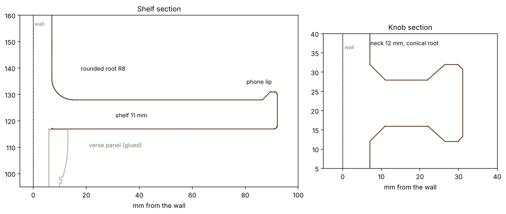
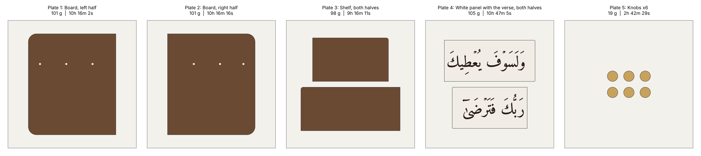
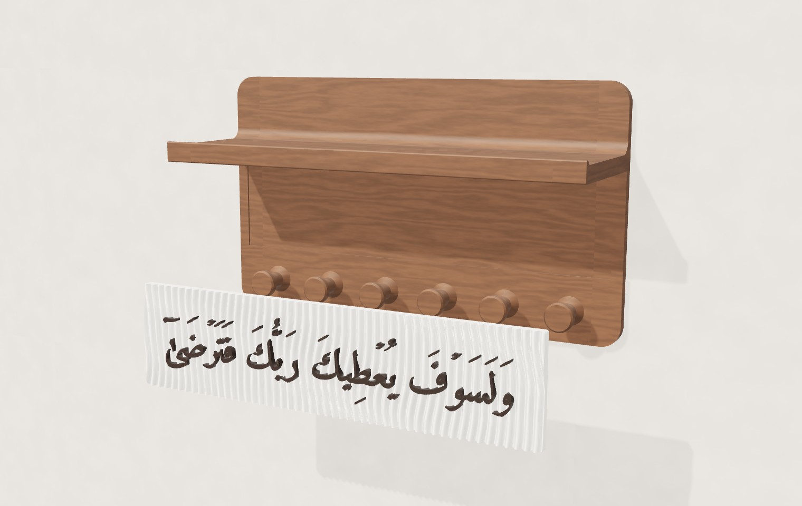

**إعادة التوليد (لأي مقاس):**
```bash
python3 05-walnut-board/build.py 30cm          # أو small
python3 05-walnut-board/measure_weight.py 30cm
python3 05-walnut-board/print_kit.py 30cm
python3 05-walnut-board/section_figure.py 30cm
python3 05-walnut-board/make_guide.py 30cm     # يحتاج PrusaSlicer و Playwright
```

### الوزن (مقاس بالسلايسر PrusaSlicer)

الإعدادات: طبقة 0.2 مم، PLA، حشو Gyroid. في المقاسين: القطعة البنية 4 جدران وحشو 15%، وقاعدة الآية 2 جدار وحشو 10%.

| | الصغير | 30 سم |
|---|---|---|
| **الوزن الكلي للقطع المطبوعة** | **≈ 242 غرام** | **≈ 418 غرام** |
| بني (اللوح والرف والمقابض) | 204 غ | 339 غ |
| أبيض + غامق (اللوح الأبيض مع الآية) | 38 غ (منها حوالي 4 غ غامق) | 79 غ (منها حوالي 8 غ غامق) |

- **البراغي:** المقاسان بدون براغي.
- **الوزن على الجدار:** حوالي **0.24 كغ** للصغير و**0.42 كغ** لمقاس 30 سم، قبل الأغراض.
- **وقت الطباعة:** بسرعات قريبة من Bambu حوالي **7 ساعات** للصغير و**12 ساعة** لمقاس 30 سم. بسرعات PrusaSlicer الافتراضية الأرقام أطول بكثير (حوالي 21 و54 ساعة).
- **التفاصيل:** الأرقام لكل قطعة موجودة في `05-walnut-board/<المقاس>/weight.json`.

### كل القطع في ملف STL واحد

`all_parts_one_file.stl` في مجلد `stl` لكل مقاس: القطعة البنية وقاعدة الآية مرتبتين جنب بعض على السرير، كل قطعة بوضعية الطباعة الصحيحة.

| | الصغير | 30 سم |
|---|---|---|
| المقاس على السرير | 210 × 181 مم، ارتفاع 92 مم | 300 × 257 مم، ارتفاع 92 مم |
| يناسب سرير | 330 × 320 (A2L)، وأيضاً 220 × 220 | 330 × 320 (A2L) |

- **STL ما يحمل ألوان.** الملف مناسب للطباعة دفعة واحدة **بلون واحد**، والآية تُقرأ من البروز.
- **لا تضف تغيير خيط بالارتفاع** على هذا الملف: التغيير يشمل كل الطبعة، فيتغيّر لون القطعة البنية أيضاً من 7 مم وفوق.
- **مع AMS:** في Bambu Studio اضغط على القطعة بالزر الأيمن ← Split ← To objects، ثم اختر لون كل قطعة. الآية تطلع بنفس لون اللوح الأبيض.
- **للبني والأبيض والآية الغامقة بأقل هدر:** استخدم ملفات الطباعة المنفصلة لكل لون.
- **إعادة التوليد:** `python3 05-walnut-board/all_in_one.py 30cm` (أو `small`).

### طباعة الآية بلونين

- **بدون طابعة ألوان:** اللوح الأبيض مع الآية قطعة واحدة (`panel_..._white_with_verse.stl`). اطبعه أبيض، وأضف **تغيير خيط** إلى اللون الغامق عند:
  - **7.0 مم** للصغير.
  - **7.4 مم** لمقاس 30 سم.

  عند هذا الارتفاع تنتهي التموّجات البيضاء، وكل ما فوقه هو الآية فقط.
- **طابعات الألوان المتعددة:** ملفات `mmu_..._white` و `mmu_..._dark` هي نفس القطعة مقسومة على لونين.
- **تفاصيل الحروف:**
  - في مقاس 30 سم: أصغر فراغ بين نقطة وحرف 0.63 مم، و0.35% فقط من الخط أرفع من 0.8 مم.
  - في المقاس الصغير: أصغر فراغ 0.47 مم، و4% من الخط أرفع من 0.8 مم. يعني الصغير على حدود دقة فتحة 0.4 مم، ومقاس 30 سم أوضح بكثير. إذا اخترت الصغير، فعّل خيار "الجدران الرفيعة" (Arachne، وهو الافتراضي في PrusaSlicer و Bambu Studio).

### التركيب

**المقاس الصغير**
1. **قاعدة الآية:** الصقها في تجويفها تحت الرف.
2. **التعليق:** علّقه على برغيين في الجدار، والمسافة بينهما 140 مم.

**مقاس 30 سم**
1. **قاعدة الآية:** الصقها في تجويفها تحت الرف.
2. **التعليق:** علّقه على برغيين في الجدار، والمسافة بينهما 220 مم.

### التقييم
- **الفحوصات:** كل القطع مغلقة، ولا يوجد تداخل بين القطع. كل القطع تُطبع بدون دعامات.
- **الرف في المقاسين:** جزء من نفس القطعة، ويحمل حتى 5 كغ بدون براغي (حساب نظري).
- **المقابض:** 1 كغ على كل مقبض يعطي إجهاداً حوالي 5 ميجاباسكال، وهذا قليل جداً.
- **الصور:** تقريبية. الخيط الخشبي لن تظهر فيه عروق الخشب كما في الصور.

---

## الملفات

```
01-mihrab/stl/          panel.stl  pocket.stl  peg.stl   (+ panel_base_black / panel_accent_gold)
02-floating-shelf/stl/  shelf.stl  calligraphy.stl  peg.stl   (+ calligraphy_base_clear / _accent_gold)
03-horizon-moon/stl/    disc.stl   shelf.stl  peg.stl   (+ disc_base_ivory / disc_accent_gold)
04-fluted-arch/stl/     panel.stl  shelf.stl  verse.stl  peg.stl
05-walnut-board/small/stl/  main_brown_board_shelf_knobs.stl  panel_white_with_verse.stl  all_parts_one_file.stl  (+ mmu_*)
05-walnut-board/30cm/stl/   main_brown_board_shelf_knobs.stl  panel_white_with_verse.stl  all_parts_one_file.stl  (+ mmu_*)   ← Bambu Lab A2L
renders/                صور العرض
```

- **الوضعية:** كل ملف STL محفوظ بالوضعية الصحيحة للطباعة.
- **ملفات اللونين:** ملفات `_base` و `_accent` هي نفس اللوح مقسوماً على لونين، لأصحاب طابعات الألوان المتعددة (AMS / MMU). استوردهما معاً كقطعة واحدة.
- **إعادة التوليد:** `python3 build_all.py` يعيد توليد كل الملفات. المقاسات في أول كل `build.py`.

## الطباعة

| | المحراب | الرف العائم | البدر والأفق |
|---|---|---|---|
| اللون الأساسي | PLA أسود مطفي | PLA خشبي أو بيج + PLA/PETG شفاف | PLA عاجي أو أبيض + PLA بلون الجوز |
| لون الخط والخطاطيف | PLA ذهبي حريري | PLA ذهبي حريري / نحاسي | PLA ذهبي حريري |
| **تغيير اللون عند** | **7.0 مم** | **3.6 مم** (لوح الخط) | **7.0 مم** |
| الخامة التقريبية | 165–205 غ | 165–200 غ | 180–215 غ |

**طريقة اللونين بدون طابعة ألوان**
1. اطبع اللوح مستلقياً على ظهره.
2. اختر ارتفاع طبقة 0.2 مم، وأول طبقة 0.2 مم، حتى يقع تغيير اللون على حد طبقة.
3. في السلايسر أضف "تغيير خيط" (Filament Change / M600) قبل الطبقة التي تبدأ عند الارتفاع المذكور في الجدول. في PrusaSlicer و Bambu Studio تظهر هذه الطبقة بارتفاع 7.2 مم (أو 3.8 مم للوح الخط).
4. كل ما فوق هذا الارتفاع هو الخط والإطار فقط، فيطلع ذهبياً على الخلفية.

**الإعدادات المقترحة**
- الفتحة: 0.4 مم.
- الجدران: 3.
- الحشو: 15–20%.
- **بدون دعامات.** كل القطع مصممة لتُطبع بدون دعامات: الجيوب والرفوف تُطبع على أرضيتها، ورف التصميم 2 يُطبع مقلوباً على سطحه، والخطاطيف تُطبع واقفة على رأسها المسطح.

## التركيب

1. **الخطاطيف:** ضع قطرة غراء (سيانو أو إيبوكسي) في فتحة كل خطاف (قطر الفتحة 8.4 مم)، ثم اضغط الخطاف حتى يلمس كتفُه اللوح.
2. **الجيب أو الرف (التصميمان 1 و 3):** ثبّته ببرغيين M3 × 12 من خلف اللوح قبل تعليقه. رأس البرغي يدخل غاطساً في الظهر، فيبقى الظهر مستوياً على الجدار.
3. **لوح الخط (التصميم 2):** أدخله في المجرى. يمكن إضافة نقطة غراء لتثبيت دائم.
4. **التعليق:**
   - التصميمان 1 و 3: برغيان 4 مم مع فيشة (قطر رأس البرغي ≤ 9 مم، وسماكته ≤ 2.4 مم). اترك مسافة 2.5 مم تقريباً بين الجدار وأسفل رأس البرغي، ثم علّق القطعة وأنزلها 10 مم.
   - التصميم 2: برغيان غاطسان تحت الرف.
   - المسافات بين البراغي: 90 مم للمحراب، و84 مم للبدر، و172 مم للرف.
5. **الارتفاع المقترح:** منتصف القطعة على ارتفاع 135–150 سم من الأرض، بجانب الباب في الجهة التي يُفتح منها، بعيداً عن مسار دفة الباب.

## مراجعة واقعية وعملية

**أولاً: فحوصات الملفات (من `report.json` لكل تصميم)**
- **السلامة:** كل القطع مغلقة (watertight).
- **المقاس:** كل قطعة تدخل في سرير طابعة 220 × 220 مم.
- **الأجزاء المعلّقة:** لا توجد أجزاء معلّقة تحتاج دعامات. ما يظهر في التقرير هو فقط أسقف فتحات صغيرة بعرض 4–10 مم، وهي تُطبع كجسور عادية.
- **دقة الخط:** أقل من 0.3% من مساحة الخط الذهبي أرفع من 0.8 مم. يعني فتحة 0.4 مم تطبع الحروف والتشكيل بوضوح.

**ثانياً: الأحمال (حسابات تقديرية لـ PLA، لم تُختبر بعد على قطعة مطبوعة)**

| الجزء | الحمل المفترض | النتيجة |
|---|---|---|
| الخطاف | 1 كغ معلّق على بعد 30 مم | أقصى إجهاد حوالي 6 ميجاباسكال عند لسان التثبيت (Ø8)، بينما قوة التصاق الطبقات في PLA حوالي 15–25 ميجاباسكال. مناسب للمفاتيح وحقيبة صغيرة، لكنه ليس لتعليق الشنط الثقيلة. |
| رف التصميم 2 | 2 كغ في منتصفه | إجهاد أقل من 1 ميجاباسكال، والرف مدعوم من الطرفين والواجهة. |
| الجيب والرف المثبّتان ببراغي M3 (التصميمان 1 و 3) | 1 كغ | الشد على البراغي حوالي 10–25 نيوتن، بينما قوة سحب برغي M3 من PLA عادةً مئات النيوتن. |

**ثالثاً: ملاحظات واقعية**
1. **رفع المفاتيح:** فتحات التعليق المخفية تجعل الشكل نظيفاً، لكن إذا رفعت المفاتيح بقوة للأعلى قد ترتفع القطعة عن البراغي. الحل: شريط لاصق مزدوج (فوم) صغير في أسفل ظهر القطعة.
2. **الشفافية في التصميم 2:** الخيط الشفاف يطلع مطفياً (مثل الزجاج المصنفر) وليس شفافاً كالأكريليك المقصوص. لو تريد شفافية تامة، يمكن قص لوح الخط من أكريليك 3 مم بالليزر، وتطبع الحروف وتلصقها عليه.
3. **الحرارة:** PLA يلين فوق حوالي 55°م. لو المدخل يتعرض لشمس مباشرة قوية أو حرارة عالية، استخدم PETG.
4. **الخطوط المستخدمة:**
   - أميري قرآن (Amiri Quran) للتصميم 1.
   - عارف رقعة (Aref Ruqaa) للتصميم 2.
   - ريم كوفي (Reem Kufi) للتصميم 3.

   كلها برخصة OFL المفتوحة، وملفاتها في `fonts/`. ليست خط يد خطاط، لكنها مصممة على أصول الخط العربي.
5. **المقاسات محكومة بسرير الطابعة:** لو سرير طابعتك أكبر (256 مم)، تقدر تكبّر المقاسات من أعلى ملف `build.py`.

## صور العرض

صور العرض مولّدة بـ three.js داخل متصفح بدون واجهة (`render/`). الألوان والإضاءة تقريبية لألوان الخيوط المقترحة.

لإعادة توليد الصور:

```bash
npm pack three@0.160.0 && tar xzf three-0.160.0.tgz
python3 build_all.py
node render/render.mjs ./package render/views/01-mihrab.json renders-out
```
