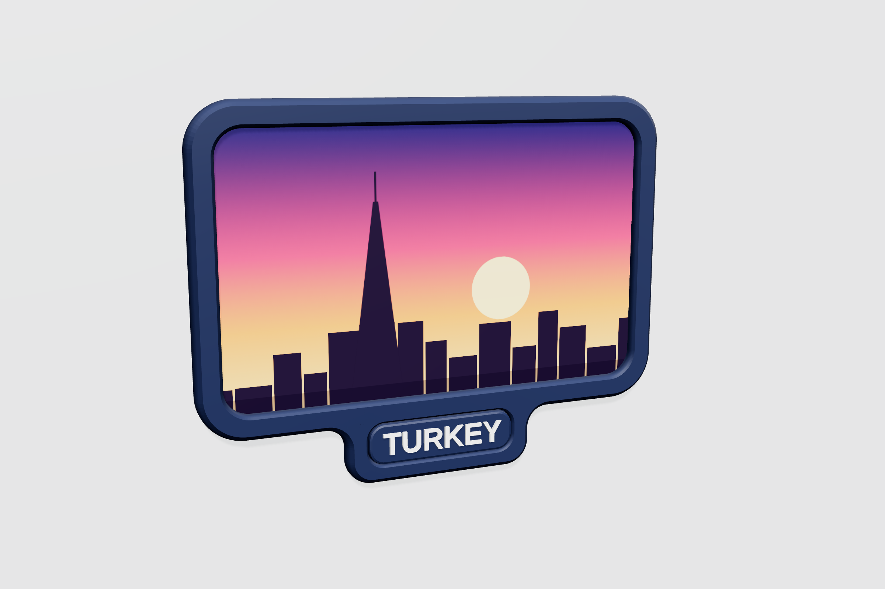
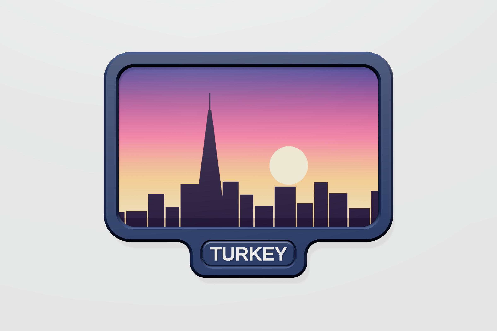
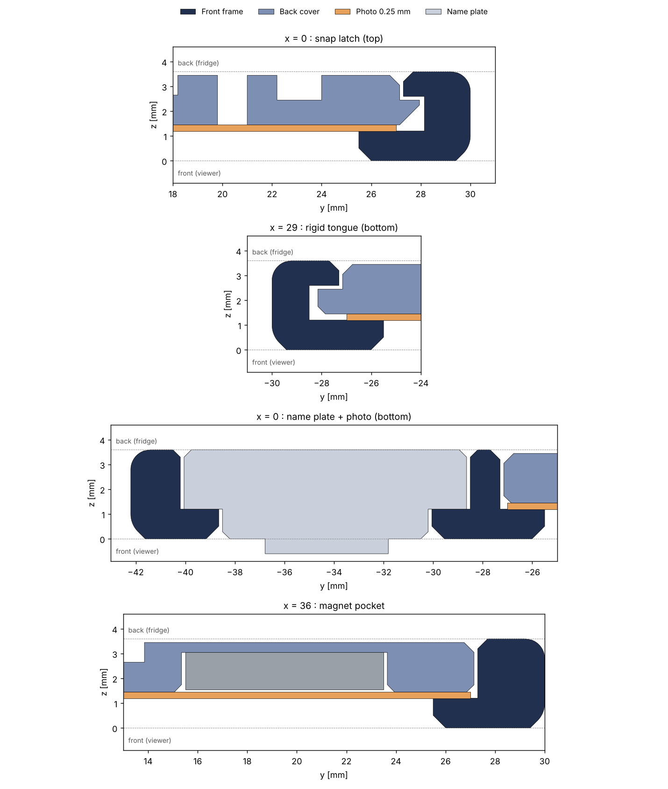
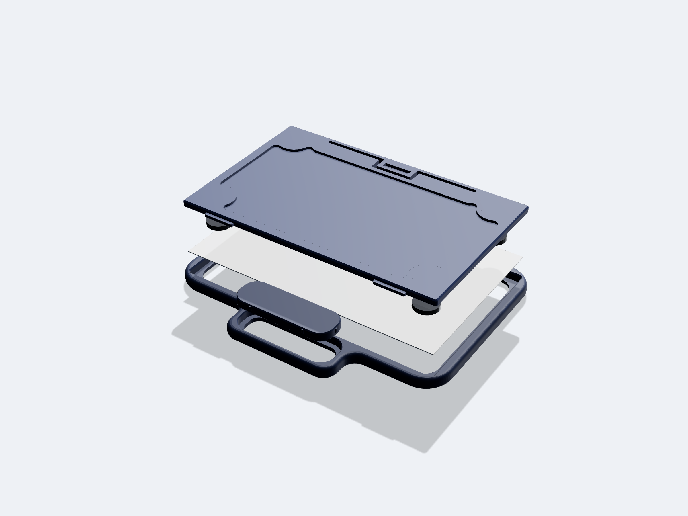
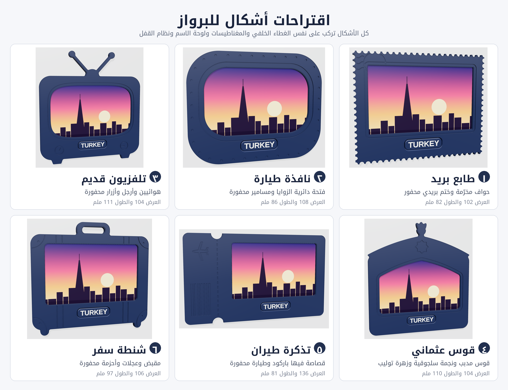
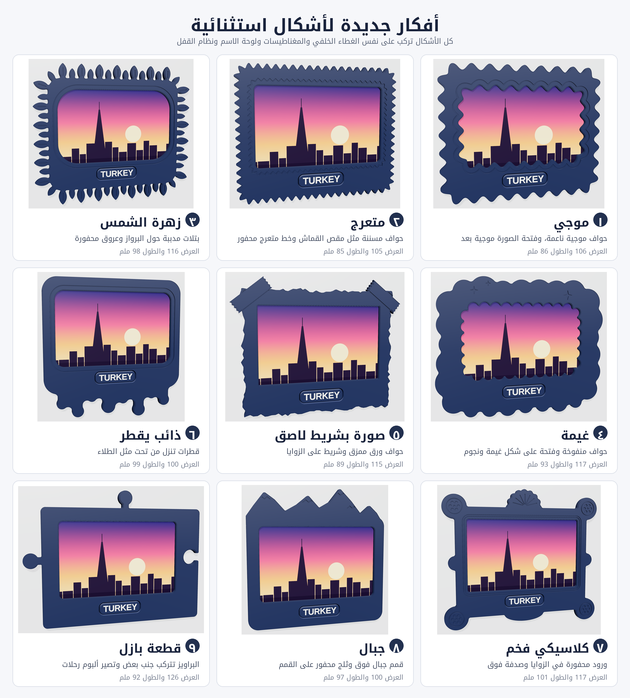

# برواز صور مغناطيسي للثلاجة (بدون زجاج أو شفاف)

## الملفات

| الملف | الوصف | طريقة الطباعة |
|---|---|---|
| `stl/frame.stl` | الفريم الأمامي | الوجه الأمامي على السرير |
| `stl/cover.stl` | الغطاء الخلفي (فيه 4 مغناطيس، لسانين وقفل كبس) | جاهز بالاتجاه الصحيح |
| `stl/nameplate_TURKEY.stl` (المعتمدة) / `nameplate_PARIS.stl` / `nameplate_2026.stl` / `nameplate_arabic_baris.stl` | لوحة الاسم TURKEY وأمثلة ثانية (كتابة بارزة، فيها 4 أذرع نابضة للتثبيت) | جاهز بالاتجاه الصحيح |
| `stl/nameplate_TURKEY_tight.stl` | نفس اللوحة بتثبيت أقوى، إذا طابعتك تطبع الفتحات واسعة | جاهز |
| `images/frame_shape_concepts.png` + `concepts/make_concepts.py` | اقتراحات أشكال جديدة للبرواز (كلها على نفس الغطاء ولوحة الاسم) | — |
| `stl/nameplate_engraved_example.stl` | مثال بكتابة محفورة | جاهز |
| `stl/print_plate_all_parts.stl` | كل القطع على سرير واحد (142 × 111 ملم) | جاهز |
| `fridge_photo_frame.scad` | الملف البارامتري (لتغيير الاسم والمقاسات) | — |
| `verify.py` + `verification_report.json` | سكربت فحص التصميم ونتيجته | — |

## المقاسات
* الفريم بنفس مقاسات الصورة المرجعية: **93.6 × 61.6 ملم**، و**لسان الاسم 38 × 11.5 ملم**، و**السماكة 4.4 ملم**.
* الزوايا مدورة (نصف قطر 9 ملم)، والحواف الأمامية والخلفية مدورة، ولوحة الاسم على شكل كبسولة.
* الحافة الأمامية سماكتها 1.8 ملم، والجدران 3.5 ملم.
* الصورة: **86 × 54 ملم** (بحجم البطاقة). يظهر منها 83.6 × 51.6 ملم، والحافة تغطي 1.2 ملم من كل جهة.
* المغناطيس: **4 حبات قرص 8 × 1.5 ملم** (يفضل N52).
* الوزن: الفريم 6.2 غ، الغطاء 9.0 غ، لوحة الاسم 1.6 غ. **المجموع تقريباً 17 غرام PLA**.

## إعدادات الطباعة (بدون دعامات Supports)
* ارتفاع الطبقة **0.2 ملم** (كل الارتفاعات في التصميم من مضاعفات 0.2)، والفوهة 0.4.
* 3 جدران، و4 طبقات علوية وسفلية، والحشوة 15% Gyroid (أغلب القطع صلبة لأنها رقيقة).
* الخامة: PLA أو PLA+. وPETG أفضل إذا تبي القفل يتحمل فتح وتسكير كثير.
* السرير المحبب (Textured PEI) يعطي وجه أمامي بلمسة فخمة.
* **لوحة الاسم بلونين:** أضف تغيير فلمنت (Color change / M600) أو إيقاف (Pause) عند الارتفاع **4.4 ملم** (بداية الطبقة 23). الكتابة بارزة 0.6 ملم فوق الوجه.

## التركيب
1. اضغط المغناطيسات الأربعة في جيوبها من **الجهة الداخلية** للغطاء (جهة الصورة). فيها أضلاع صغيرة تمسكها، فما تحتاج غراء. المغناطيس يبقى مخفي خلف طبقة 0.4 ملم، فما يخدش الثلاجة.
2. اقلب الفريم على وجهه وحط الصورة ووجهها لتحت.
3. دخّل **اللسانين السفليين** للغطاء في الشقوق اللي تحت وهو مايل، ثم اضغط طرفه العلوي لين تسمع **كليك**.
4. لوحة الاسم: ادفعها من الخلف في فتحة اللسان لين تصير مستوية مع الظهر. فيها 4 أذرع صغيرة نابضة تضغط على جدار الفتحة فتثبتها، وفي الفريم الجديد تسمع كليك.

## الفتح والتسكير
* **الفتح:** حط ظفرك في الحفرة الصغيرة اللي في أعلى الغطاء، واسحبها باتجاه منتصف البرواز حوالي 1 ملم. القفل ينفك فترفع الغطاء (قوة السحب تقريباً 4 نيوتن). ولو تبي أسهل، ادفع الصورة من قدام بإصبعك وأنت ساحب القفل.
* **التسكير:** اللسانين أولاً، ثم اضغط الطرف العلوي لين تسمع كليك.
* **تبديل الاسم بدون ما تفتح البرواز:** اسحب البرواز من الثلاجة، وادفع لوحة الاسم من قدام بإبهامك فتطلع من الخلف. دخّل اللوحة الجديدة من الخلف. وهو على الثلاجة، الثلاجة نفسها تمسك اللوحة من ورا.

## عمل لوحة اسم جديدة (اسم دولة أو تاريخ، عربي أو إنجليزي)
1. افتح `fridge_photo_frame.scad` في [OpenSCAD](https://openscad.org)، أو ارفعه على **MakerWorld → Parametric Model Maker**.
2. اختر `part = insert` واكتب النص في `label`. وفيه `second_line` لو تبي سطر ثاني صغير.
3. اضغط F6 للمعاينة، ثم F7 للتصدير بصيغة STL.
* النص يصغر تلقائياً إذا كان طويل عشان يدخل في اللوحة. الأفضل **10 أحرف أو أقل**. وإذا صار النص صغير بزيادة، يطلع لك تحذير في نافذة الـ Console.
* الخط العربي المستخدم Noto Kufi Arabic Bold. إذا ما كان عندك، ثبته أو غيّر `font_arabic`.

## تطبيق صانع لوحة الاسم
تطبيق في المتصفح تكتب فيه أي اسم أو تاريخ بالعربي أو الإنجليزي، وتختار من أكثر من 50 خط (أو ترفع خطك الخاص)، وتضيف رموز (قلب، نجمة، طيارة، نخلة، توليب...)، وتتحكم في الحجم وسماكة الحروف والتباعد وارتفاع البروز أو عمق الحفر. يعطيك ملف ZIP فيه:
* ملف STL للوحة كاملة (للطباعة بلون واحد، مع تغيير الفلمنت عند 4.4 ملم للكتابة).
* ملفين `_base` و `_text` للطباعة بلونين على AMS.
* ملف طريقة الطباعة.

اللوحة في التطبيق هي نفس اللوحة المفحوصة بالضبط (فيها الأذرع النابضة، وتشتغل على الفريم القديم والجديد). الملف: `app/nameplate_maker.html`، والمصدر في `app/src/`.

## تعديلات حسب طابعتك
| المشكلة | الحل |
|---|---|
| الصورة سميكة (Instax أو كرت) | `photo_space = 0.8` (يزيد سماكة البرواز إلى 4.8 ملم) |
| الغطاء ضيق أو واسع | `cover_clr` (الافتراضي 0.15) |
| لوحة الاسم قاسية أو رخوة | `plate_grip`: الافتراضي 0.45، وإذا رخوة خله 0.6 (أو اطبع `nameplate_TURKEY_tight.stl`)، وإذا قاسية خله 0.3 |
| المغناطيس رخو | `mag_grip = 0.1`، أو نقطة غراء |
| مقاس صورة مختلف | `photo_w` و `photo_h` |

## نتيجة الفحص والمراجعة: 90 من 90 فحص ناجح
فحصت الملفات بسكربت `verify.py` على الهندسة الفعلية لملفات STL:

* **سلامة الملفات:** كل الملفات مغلقة (watertight) و manifold، وكل ملف جسم واحد بدون أخطاء.
* **التجميع الافتراضي:** ما فيه أي تداخل بين الفريم والغطاء والصورة. الخلوص 0.145 ملم من كل جهة.
* **اختبار السحب:** إذا تحرك الغطاء 0.15 ملم باتجاه الثلاجة، يصطدم بالفريم عند القفل واللسانين. يعني البرواز ما ينفك لما تسحبه من الثلاجة.
* **اختبار التركيب بالإمالة:** دخول اللسانين وتدوير الغطاء من 25° إلى 0° يتم بدون اصطدام.
* **القفل:** يحتاج حركة 0.65 ملم عشان يكبس، والشق يسمح بـ 1.2 ملم كحد أقصى (يحمي القفل من الكسر). أعلى انفعال في البلاستيك 1.35%، وهو أقل من حد PLA اللي هو 2%.
* **الطباعة:** ما يحتاج دعامات. كل الميول 45° أو أقل، والجسور قصيرة (أطولها 8.3 ملم فوق جيوب المغناطيس).
* **الجدران:** أقل جدار عمودي 1.2 ملم في الغطاء، و1.4 ملم في الفريم (عند الزوايا المدورة فقط)، والباقي 3.5 ملم.
* **لوحة الاسم:** تتداخل مع الفتحة 0.1 ملم عند 4 أضلاع فقط (تثبيت بالضغط)، ووجهها مستوي مع الفريم. جربت 12 نص عربي وإنجليزي وكلها دخلت داخل الكبسولة مع هامش 0.6 ملم.

### التحديث الثالث: تثبيت لوحة الاسم (بعد تجربة الطباعة)
* **المشكلة:** لوحة الاسم كانت تدخل بسهولة زيادة وتطيح لو قلبت البرواز.
* **السبب:** التثبيت كان معتمد على 4 نتوءات صغيرة بارزة 0.25 ملم بس، وبرنامج التقطيع (السلايسر) ينعّمها فتختفي، ويصير فيه فراغ.
* **الحل:** 4 أذرع نابضة طولها 10 ملم، داخل اللوحة نفسها، وفي طرف كل ذراع بروز يضغط على جدار الفتحة 0.45 ملم. لأنها نابضة، تتحمل فرق الطابعة حتى ±0.2 ملم وتبقى ماسكة.
* **في الفريم اللي طبعته (ما يحتاج تعيد طباعته):** اللوحة تمسك بقوة احتكاك تقريباً 1.1 نيوتن، يعني 65 ضعف وزنها، وتطلع بدفة خفيفة من قدام.
* **في الفريم الجديد:** أضفت مجاري صغيرة في جدار الفتحة، فاللوحة تدخل **بكليك** وتطلع بدفة إبهام متوسطة (تقريباً 6.6 نيوتن).
* **فحصت الحركة كاملة:** دخلت اللوحة وطلعتها خطوة خطوة في الفريم القديم والجديد. أقصى انحناء للذراع 0.45 ملم، والشق يسمح بـ 0.65، والإجهاد 0.77%. ما فيه أي جزء ثاني يحتك.

### التحديث الثاني: الشكل مثل الصورة المرجعية وأقوى
* المقاسات الخارجية صارت 93.6 × 61.6 × 4.4 ملم، ولسان الاسم 38 × 11.5 ملم، مثل الصورة.
* الحواف مدورة، والزوايا كبيرة، والفتحة زواياها مدورة، ولوحة الاسم على شكل كبسولة.
* **القوة:** الحافة الأمامية صارت 1.8 ملم بدل 1.2، والجدران 3.5 ملم بدل 2.7، والسماكة 4.4 بدل 3.6. صلابة الفريم ضد الانحناء تقريباً الضعف.
* **الشيء الوحيد اللي يختلف عن الصورة:** الإطار الظاهر 5 ملم بدل 3.8. لو كان 3.8 ملم والصورة 86 × 54، ما يبقى شيء يغطي حافة الصورة ويمسكها، لأن ما فيه شفاف قدامها.
* الغطاء الخلفي ما يغطي اللسان، عشان تقدر تبدل الاسم بدون ما تفتح البرواز.

### أخطاء اكتشفتها المراجعة وصلحتها قبل التسليم
1. **أداة الحواف المشطوفة كانت توسّع الفتحات:** كانت تكبّر فتحة الصورة وجيبها وفتحة الاسم حتى 0.7 ملم، فتصير الصورة رخوة، والقفل يمسك 0.2 ملم بس بدل 0.65، ولوحة الاسم ما تثبت. تم التصحيح، والقيم الحين مطابقة للتصميم.
2. **النصوص الطويلة** مثل SAUDI ARABIA كانت تطلع خارج اللوحة. صلحت تقدير العرض وأضفت تحذير.
3. حواف صغيرة عند السرير كانت أكثر من 45°، صارت 45° بالضبط. والجدار اللي يدفه الظفر عند القفل صار أعرض (1.2 ملم).

## اقتراحات أشكال جديدة للبرواز

### المجموعة الثانية: أشكال استثنائية (موجي، متعرج، زهرة، غيمة، ورق ممزق، ذائب، كلاسيكي، جبال، بازل)

* **نفس الغطاء الخلفي والمغناطيس ولوحة الاسم ونظام القفل لكل الأشكال.** اللي يتغير بس الشكل الخارجي، وشكل فتحة الصورة، والنقوش المحفورة على الوجه.
* **فحصت كل شكل:** يغطي جيب الصورة وفتحة الاسم ومجاري القفل بالكامل، وفتحة الصورة داخل حدود الصورة، والملف سليم.
* **هذي اقتراحات للحين.** لما تختار الشكل اللي يعجبك، أفرّغه من الخلف عشان يخف الفلمنت، وأسوي له الفحص الكامل.
