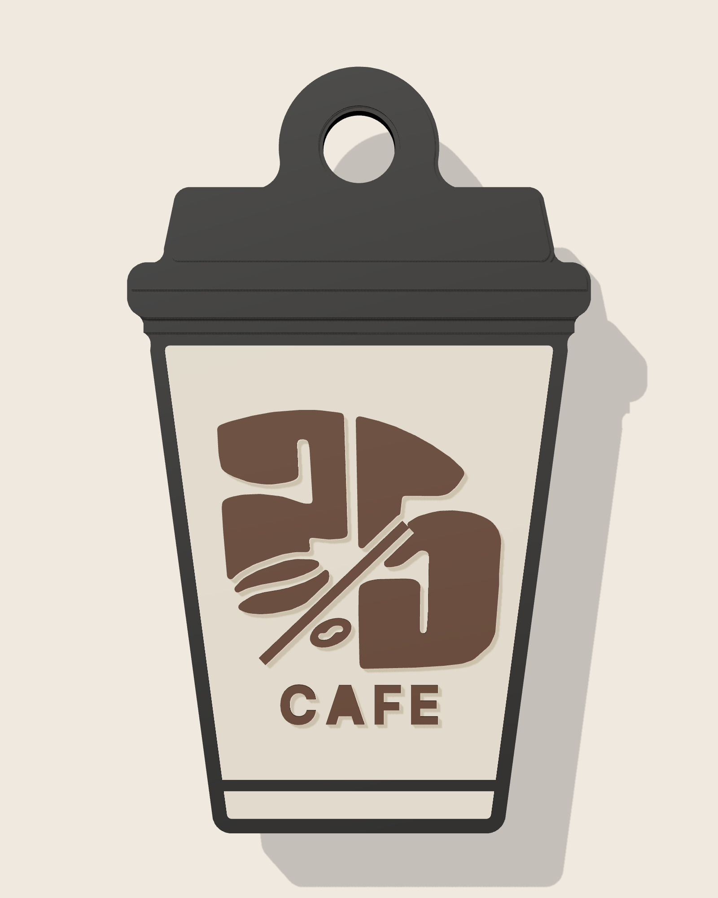

# 25 Percent Cafe – cup keychain (3 colours)

| | |
|---|---|
| Size | **28.6 × 47.6 × 4.8 mm** (cup 40 mm + key-ring loop) |
| Key-ring hole | Ø 4.5 mm, 2.75 mm wall around it |
| Colours | 1 Black (lid, outline, back, loop) · 2 Beige (cup) · 3 Dark brown (logo, raised 0.6 mm) |
| Weight | ≈ 4–5 g PLA per keychain |
| Supports | none — prints face-up on its flat back |
| Colour changes | ≈ 12 per plate, the same for 1 or 50 keychains |
| Per plate (A2L, 330 × 320 mm) | about 50 pieces + prime tower |

## Files

| File | Use |
|---|---|
| `25cafe_cup_keychain.3mf` | **Open this one.** One object, three named parts (one per colour). |
| `25cafe_cup_keychain_1_black.stl` / `_2_beige.stl` / `_3_brown.stl` | Same model as three STL files (backup). |
| `previews/` | Renders, plate layout and dimension drawing. |
| `source/` | Scripts that generate the model (to change size, text, etc.). |

## Print it in Bambu Studio (A2L Combo, 0.4 mm nozzle)

1. Load the AMS Lite: e.g. slot 1 **black**, slot 2 **beige**, slot 3 **dark brown** (matte PLA looks closest to a paper cup).
2. Open `25cafe_cup_keychain.3mf`.
   *If you use the STLs instead, select all three and drag them in together, then answer **Yes** to "load as a single object with multiple parts".*
   *If the 3 parts ever appear as 3 separate objects, select all 3 → right-click → **Assemble**.*
3. In the object list expand the object and set the filament of each part: `1 - Black` → black slot, `2 - Beige` → beige slot, `3 - Dark brown` → brown slot.
4. Settings:
   - Layer height **0.20 mm** (all colour borders are on 0.2 mm steps; 0.10 also works, do **not** use 0.12/0.16/0.24)
   - Walls 3, infill 15 %, no supports, no brim
   - Prime tower on (default). Optional: *Flush into objects' infill* to waste less filament.
   - Textured PEI plate gives a nice back. Wash the plate with dish soap for small parts.
5. Make the plate: right-click the keychain → **Clone** → e.g. 49 copies → press **A** (arrange). The copies keep the colour settings.
6. Slice and check **Preview** (colour by filament) before printing. Print **one** test keychain first, then the full plate.

**Tip:** for keys that stay in a hot car, print in **PETG**. PLA can soften in a car in summer.

## Small changes made for printing with a 0.4 mm nozzle

The logo was traced from the cup photo, flattened from the round cup and cleaned up. A few details were adjusted so every line is at least about 0.4 mm wide:

- **CAFE** is under the "25" at 2.4 mm tall. In its original spot it could only be about 1.6 mm, which is too small to print sharply.
- The **slash** is 0.6 mm wide and has a 0.45 mm gap on each side.
- The **small coffee bean** is slightly bigger, with a shorter crease.

## Checks done on the exported files (`source/verify_report.json`)

- All 3 parts are watertight with consistent winding, and no colour overlaps another.
- The assembled keychain is a single solid with one through-hole.
- No overhangs.
- Colour layers: 0–2.4 black · 2.4–4.0 black + beige · 4.0–4.6 black + brown · 4.6–4.8 black.

Regenerate: `python3 source/build.py source/logo_trace.wkt out && python3 source/export.py out . 25cafe_cup_keychain`
(needs `shapely manifold3d trimesh scipy matplotlib`).
