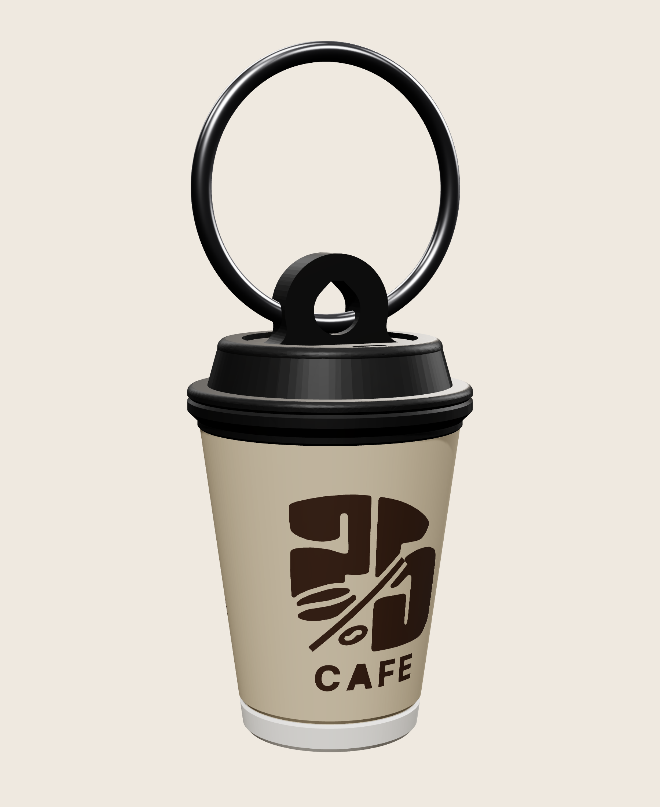

# 25 Percent Cafe – 3D mini cup keychain (4 colours)

A small, solid copy of the takeaway cup: tapered cup, black lid with rim and sip slot, white rolled bottom, logo wrapped on the front, "TWENTY-FIVE PERCENT CAFE" and the Instagram handle on the back, and a key-ring loop on the lid.

| | |
|---|---|
| Size | **Ø 25.8 mm (lid rim) × 43.6 mm tall** (cup 36 mm + loop) |
| Key-ring hole | 4.5 mm teardrop (prints without support), 3.4 mm thick loop |
| Colours | 1 Black (lid + loop) · 2 Beige (cup) · 3 Dark brown (logo + text) · 4 White (bottom ring; use beige if you have no white) |
| Logo / text | inlaid flush into the wall, 0.9 mm deep |
| Weight | about 6–8 g PLA each (15 % infill) |
| Supports | none — prints upright in one piece |
| Colour changes | **144 per plate at 0.12 mm**, 86 at 0.20 mm. The count is the same for 1 or 36 cups, so fill the plate. |

## Files

| File | Use |
|---|---|
| `25cafe_3d_cup_keychain.3mf` | **Open this.** One object with four named parts, one per colour. |
| `25cafe_3d_cup_keychain_1_black.stl` … `_4_white.stl` | Same model as four STL files (backup). |
| `previews/` | Renders, plate layout, dimension drawing. |
| `source/` | Generator and check scripts. |

## Print it in Bambu Studio (A2L Combo, 0.4 mm nozzle)

1. Load the AMS Lite, for example: slot 1 **black**, 2 **beige**, 3 **dark brown**, 4 **white**. Matte PLA looks most like a paper cup.
2. Open the 3MF and set each part's filament: `1 - Black` → black, `2 - Beige` → beige, `3 - Dark brown` → brown, `4 - White` → white (or beige).
   *Using the STLs instead: drag all four in together and answer **Yes** to "load as a single object with multiple parts". If they ever load as 4 objects: select all → right-click → **Assemble**.*
3. Process settings:
   - **0.12 mm Fine** layers give the sharpest logo and text on the curved wall. 0.20 mm is faster, but the logo edges are a little steppier.
   - Walls 3, infill 15 %, **no supports**.
   - **Seam position: Back.** The model is turned so the back (+Y) is a blank strip between the logo and the text.
   - Prime tower: on (default). Turn on **Flush into objects' infill**. With many cups on the plate, most of the purge goes inside the cups instead of being wasted.
   - Brim: not normally needed on textured PEI. If a cup ever gets knocked over, add a 3 mm outer brim.
4. Fill the plate: right-click the cup → **Clone** → 35 → press **A** (arrange). Copies keep their colours. 36 per plate is a good batch; about 90 fit.
5. Slice and check **Preview** (colour by filament) before printing. Print **one** test cup first.
6. Put a split ring or ball chain through the loop.

## Changes from the paper cup, for a 0.4 mm nozzle

- **CAFE** sits under the "25" at 2.4 mm tall. In its original spot it would be too small to print.
- The **slash** is 0.6 mm wide, and the **small bean** is slightly bigger.
- The back text is set as **two lines** in bold, 2.2 mm tall: "TWENTY-FIVE / PERCENT CAFE". On one line it would wrap almost into the logo.
- The handle uses a simplified **Instagram icon** instead of "@", because "@" is too detailed at 2 mm.

## Checks run on the exported files (`source/verify_report_*.json`)

- All 4 STL files reload watertight with consistent winding and no zero-area triangles.
- No colour overlaps another. Sliced every half-layer like a slicer: each layer is one solid island with no gaps between colours.
- No overhangs steeper than 45° except the planned 1.2 mm bridge at the top of the key-ring hole.
- Colour layers: 0–2.7 mm white · 2.7–5.9 beige · 5.9–23.8 beige + brown (8.4–9.4 beige only) · 23.8–28 beige · 28–43.6 black.
