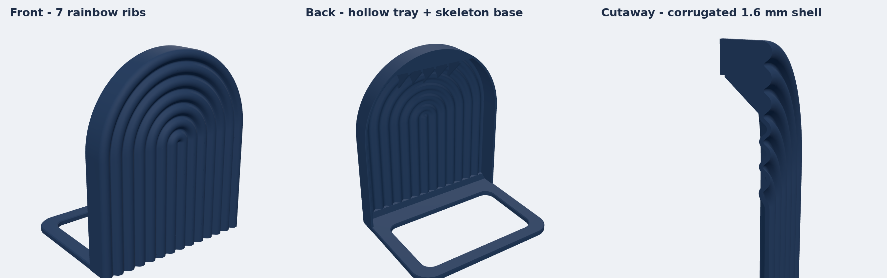

# Arch Book Divider – filament-optimized (STL / 3MF)

| File | What it is |
|---|---|
| `book_divider.3mf` | Print-ready model (mm), opens in Bambu Studio / Orca / PrusaSlicer / Cura |
| `book_divider.stl` | Same model as STL |
| `book_divider.py`  | Parametric generator (`pip install manifold3d numpy && python book_divider.py`) |

**Size:** 135 W × 155 H × 105 D mm, arch 20 mm deep, base 4.5 mm thick (85 mm protrusion).

## Lightweight design
- Rainbow ribs are a **corrugated 1.6 mm shell** (hollow from behind) instead of solid ribs.
- **Open back tray** with a 2 mm rim – books lean on the rim.
- **Skeleton base** with a big lightening window.
- Top of the tray has a flat ceiling carried by 5 small 45° corbels → bridges ≤ 12 mm.
- Rib flanks ≤ 48°, so everything prints **upright with no supports**.

## Print settings (tested in PrusaSlicer 2.7)
| Setting | Value |
|---|---|
| Orientation | As exported – base flat on the bed |
| Supports | **Off** (ignore a "long bridging" note – real spans are ≤ 12 mm) |
| Layer height | 0.2 mm, nozzle 0.4 mm |
| Walls | 3 (2 also fine) |
| Top / bottom layers | 4 / 3 |
| Infill | 10 % Gyroid (or 8 % Lightning) |
| Material | PLA or PETG (matte navy looks like the reference) |

| Profile | Filament | Time (fast CoreXY) | Time (standard ~60 mm/s) |
|---|---|---|---|
| 3 walls, 10 % gyroid | **81 g** | ~3 h 35 m | ~7 h |
| 2 walls, 8 % lightning | **77 g** | ~3 h 10 m | ~6 h 30 m |

Print two for a pair of bookends.
