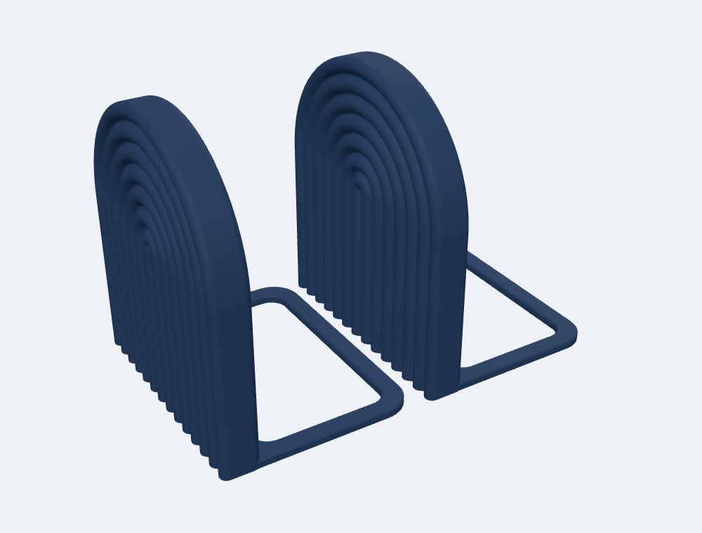

# Arch Book Divider – filament-optimized (STL / 3MF)

| File | What it is |
|---|---|
| `book_divider.3mf` | Print-ready model (mm), opens in Bambu Studio / Orca / PrusaSlicer / Cura |
| `book_divider.stl` | Same model as STL |
| `book_divider_x2.3mf` | **Pair ready to print** – 2 pieces laid out on one plate (218 × 135 mm) |
| `book_divider_x2.stl` | Same pair as one STL |
| `book_divider.py`  | Parametric generator (`pip install manifold3d numpy && python book_divider.py`) |

**Size:** 135 W × 155 H × 105 D mm, arch 20 mm deep, base 4.5 mm thick (85 mm protrusion).

## Design
- Closed arch with 7 rainbow ribs (3 mm deep) on **both faces** – the back looks the same as the front; books rest on the rib crests.
- Only the **base is hollow**: skeleton frame (10 mm bars) with a large lightening window.
- Rib flanks ≤ 48°, so it prints **upright with no supports**.

## Print settings – the infill type is what saves filament
The arch is modelled solid on purpose; the slicer fills it. With a closed arch the
infill pattern decides the weight, so **use Lightning infill**:

| Profile | Filament | Fast CoreXY | Standard ~60 mm/s |
|---|---|---|---|
| **2 walls + Lightning 8 % (recommended)** | **~65 g** | ~2 h 55 m | ~5 h 30 m |
| 3 walls + Lightning 10 % (stiffer) | ~90 g | ~3 h 50 m | ~6 h 40 m |
| 2 walls + Grid 15 % (typical default – avoid) | ~125 g | ~4 h 30 m | – |

Other settings: base flat on the bed, supports **off**, 0.2 mm layers, 0.4 mm nozzle,
4 top / 3 bottom layers, PLA or PETG.

**Pair file (`book_divider_x2.3mf`):** ~129 g total, ~5 h 55 m on a fast CoreXY
(~11 h 20 m at standard speed). Needs a bed of at least ~230 × 150 mm
(Bambu X1/P1/A1, Prusa MK4/MK3 …). On a 220 × 220 bed print the single file twice.

(Measured with PrusaSlicer 2.7. Ribs on the back cost ~4 g vs. a flat back; reducing the arch depth to 15 mm only saves ~2 g, so it stays 20 mm.)
