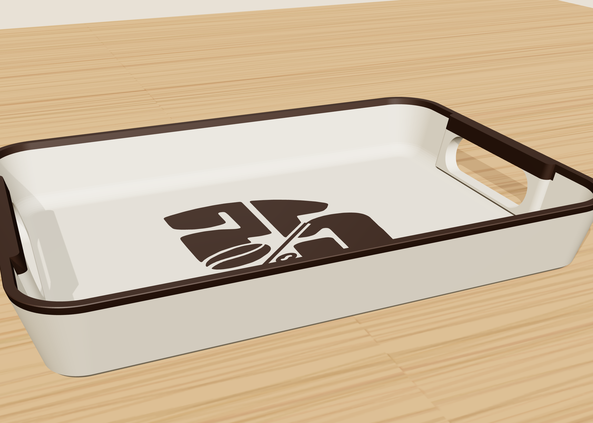
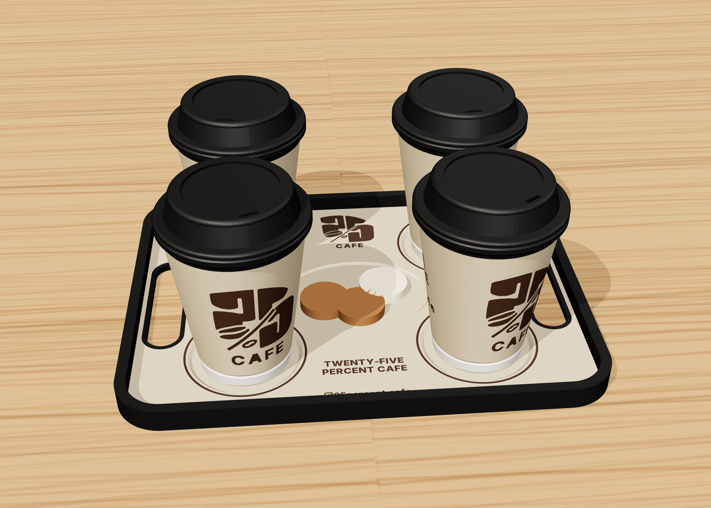

# 25 Percent Cafe – serving set

## NEW: classic serving tray (from your reference picture)

| | |
|---|---|
| File | `classic_tray/25cafe_classic_tray.3mf` (+ 2 STLs) |
| Size | **302 × 210 × 42 mm**. It fits the A2L plate with room for the prime tower |
| Shape | sloped walls, rounded corners, rounded inside corners (easy to wipe clean), dark-brown rim |
| Handles | a hand slot in each end wall (84 × 24 mm), with a thicker dark-brown grip above it |
| Logo | **only the "25 CAFE" logo, in the middle of the floor** (114 × 104 mm), inlaid flush so cups stand flat |
| Holds | 4 takeaway coffees + sweets (flat floor about 256 × 164 mm) |
| Colours | **only 2 filaments**: 1 Beige (tray), 2 Dark brown (rim, handle grips, logo) |
| Colour changes | about 29 per print |
| Weight (estimate) | ≈ 230–260 g (Bambu Studio shows the exact number) |
| Underside | 4 pockets for 10 mm round rubber bumper feet (optional) |

**Print:** one tray per plate, **no supports**, 0.20 mm layers, 2 walls, 15 % infill. **PETG** is recommended for hot coffee. The top of each hand slot is a short bridge (about 60 mm), which Bambu printers handle with their default bridge settings.

---

## NEW: 4-cup serving tray (fits the A2L plate)

| | |
|---|---|
| File | `tray_4cups/25cafe_tray_4cups.3mf` (+ 3 STLs) |
| Size | **310 × 232 × 16 mm**. It fits the A2L plate (330 × 320) with room for the prime tower |
| Holds | **4 coffees**: four cup pockets for cup bottoms up to Ø 69 mm. Cups are spaced so 12 oz takeaway cups (≈ 92 mm across the top) don't touch each other or the rim |
| Sweets | oval dish in the middle, 104 × 76 mm, 1.6 mm deep |
| Carry | a hand slot at each end (22 × 90 mm) and a 1 cm raised rim |
| Design | logo between the top cups, "TWENTY-FIVE PERCENT CAFE" and the Instagram handle between the bottom cups, a thin brown ring around each cup pocket, two coffee beans |
| Underside | 6 pockets for **10 mm round rubber bumper feet** (optional) |
| Weight (estimate) | ≈ 200–250 g (Bambu Studio shows the exact number) |
| Colour changes | 22 per print |

Print: one tray per plate, flat, **no supports**, 0.20 mm layers, 2 walls, 10–15 % infill. **PETG** is recommended for hot coffee. On a print this large, if the corners lift, add a 5 mm brim.

---

## Coaster and single-cup tray

Both pieces use the same look as the cup: **black** base and raised rim, **beige** top, and the **dark-brown** logo inlaid flush into the surface, so cups stand perfectly flat on it. All the colour is in the top layers, so each plate has only a few colour changes.

| | Coaster | Serving tray |
|---|---|---|
| Size | Ø 100 × 5 mm | 220 × 130 × 8.2 mm |
| Design | logo in the centre, "TWENTY-FIVE PERCENT CAFE" curved on top, Instagram handle curved below, two coffee beans | cup pocket (fits cup bottoms up to Ø 69 mm) with the cafe name around it; big logo on the other side for a cookie or napkin |
| Drip rim | 1 mm raised black rim | 3 mm raised black rim |
| Underside | flat | 4 pockets for **10 mm round rubber bumper feet** (optional, stops sliding) |
| Weight (estimate) | ≈ 21–25 g | ≈ 75–90 g |
| Per A2L plate | 8 + prime tower | 2 + prime tower |
| Colour changes | 12 per plate | 22 per plate |

## Material — important for hot coffee
- **Use PETG** (for example Bambu PETG HF) for pieces that will hold **hot drinks**. PLA starts to soften at about 55–60 °C, so a hot cup can leave a ring mark or slightly bend a PLA coaster or tray over time.
- PLA is fine for cold drinks, takeaway cups and display.
- 3D prints have tiny layer lines that are hard to clean, so **don't put unwrapped food directly on the tray.** Use a small napkin or paper under cookies.

## Print settings (Bambu Studio, A2L Combo, 0.4 mm nozzle)
1. Open `coaster/25cafe_coaster.3mf` or `tray/25cafe_serving_tray.3mf`.
2. Set the part filaments: `1 - Black` → black, `2 - Beige` → beige, `3 - Dark brown` → brown.
3. Use the **0.20 mm Standard** profile (keep layer height **0.20**: the colour borders are on 0.2 mm steps). Walls 2, infill 15 %, top shell layers 5, **no supports**.
4. Prime tower on, **Flush into objects' infill** on.
5. Fill the plate: coaster → Clone 7 (8 total); tray → Clone 1 (2 total). Press **A** to arrange.
6. Check Preview, then print.

## Checks on the exported files (`source/verify_*.json`)
- All parts are watertight; no colour overlaps another; each piece is one solid body.
- No overhangs, except the small bridges over the rubber-feet pockets under the tray (10 mm bridges print easily).
- All logo and text lines are at least about 0.42 mm wide (only tiny corners inside letters are smaller).
