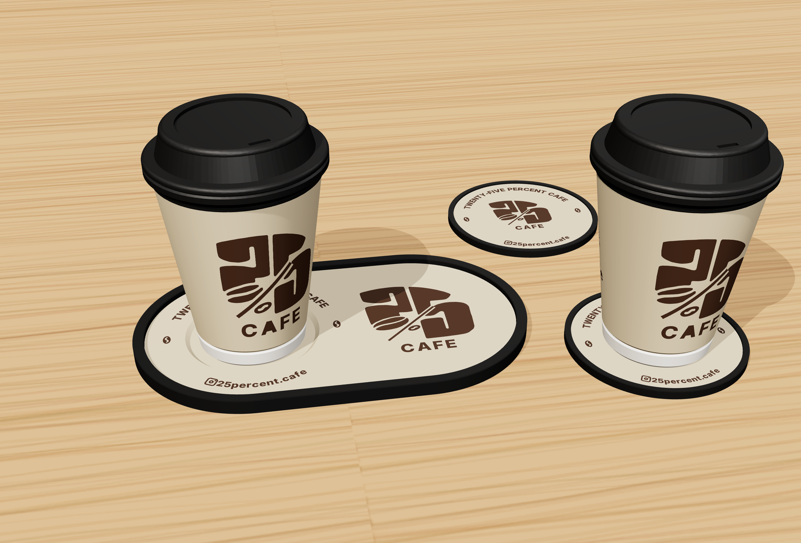

# 25 Percent Cafe – serving set (coaster + serving tray)

Both pieces use the same look as the cup: **black** base and raised rim, **beige** top, and the **dark-brown** logo inlaid flush into the surface, so cups stand perfectly flat on it. All the colour is in the top layers, so each plate has only a few colour changes.

| | Coaster | Serving tray |
|---|---|---|
| Size | Ø 100 × 5 mm | 220 × 130 × 8.2 mm |
| Design | logo in the centre, "TWENTY-FIVE PERCENT CAFE" curved on top, Instagram handle curved below, two coffee beans | cup pocket (fits cup bottoms up to Ø 69 mm) with the cafe name around it; big logo on the other side for a cookie or napkin |
| Drip rim | 1 mm raised black rim | 3 mm raised black rim |
| Underside | flat | 4 pockets for **10 mm round rubber bumper feet** (optional, stops sliding) |
| Weight (estimate) | ≈ 21–25 g | ≈ 75–90 g |
| Per A2L plate | 8 + prime tower | 2 + prime tower |
| Colour changes | 12 per plate | 22 per plate |

## Material — important for hot coffee
- **Use PETG** (for example Bambu PETG HF) for pieces that will hold **hot drinks**. PLA starts to soften at about 55–60 °C, so a hot cup can leave a ring mark or slightly bend a PLA coaster or tray over time.
- PLA is fine for cold drinks, takeaway cups and display.
- 3D prints have tiny layer lines that are hard to clean, so **don't put unwrapped food directly on the tray.** Use a small napkin or paper under cookies.

## Print settings (Bambu Studio, A2L Combo, 0.4 mm nozzle)
1. Open `coaster/25cafe_coaster.3mf` or `tray/25cafe_serving_tray.3mf`.
2. Set the part filaments: `1 - Black` → black, `2 - Beige` → beige, `3 - Dark brown` → brown.
3. Use the **0.20 mm Standard** profile (keep layer height **0.20**: the colour borders are on 0.2 mm steps). Walls 2, infill 15 %, top shell layers 5, **no supports**.
4. Prime tower on, **Flush into objects' infill** on.
5. Fill the plate: coaster → Clone 7 (8 total); tray → Clone 1 (2 total). Press **A** to arrange.
6. Check Preview, then print.

## Checks on the exported files (`source/verify_*.json`)
- All parts are watertight; no colour overlaps another; each piece is one solid body.
- No overhangs, except the small bridges over the rubber-feet pockets under the tray (10 mm bridges print easily).
- All logo and text lines are at least about 0.42 mm wide (only tiny corners inside letters are smaller).
